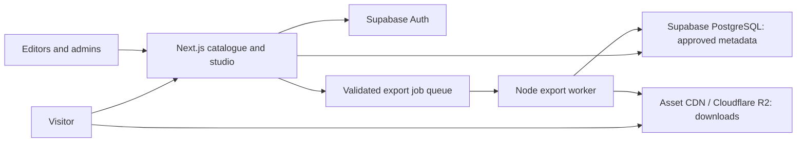

# Architecture and growth plan

Status: proposed production architecture. The current application uses a local typed seed catalogue and browser-local editing. No production backend exists yet.

## Boundaries

The website owns navigation, search, artwork metadata, role-checked publishing, and job submission. R2 owns binary assets. PostgreSQL owns relationships and publication state. The worker owns expensive rendering and preflight. Anonymous browsing and downloads remain possible independently of accounts or the export worker.

## Future data model

| Entity | Important fields / relationships |
| --- | --- |
| `artworks` | UUID, unique slug, kind, title, description, locale, contributor, collection, status, publication time, current edition |
| `artwork_editions` | Artwork FK, immutable revision, language, licence, remix permission, print notes, source asset reference |
| `asset_files` | Edition or element FK, role, object key, MIME, bytes, SHA-256, width/height px, width/height mm, DPI, colour profile, bleed, font preflight status |
| `collections` | UUID, unique slug, title, description, ordering and visibility |
| `tags` / `artwork_tags` | Normalised tags with a join table |
| `contributors` | Display name and approved credit URL; no unnecessary personal data |
| `licences` | Identifier, licence URL, attribution requirements, permission description |
| `elements` | Kind, approved source file, licence, attribution, searchable tags, remix permission, visibility |
| `templates` | Immutable versioned scene document, supported dimensions, referenced approved element versions |
| `designs` | Owner, document schema version, revision, private document JSON, timestamps |
| `export_jobs` | Owner or short-lived anonymous capability, document hash, export settings, status, failure category, result object key, expiry |
| `admin_events` | Publishing changes, actor, time, target revision; omit document contents |

Add constraints for slugs, file roles, owner IDs, allowed statuses, and compatible edition sizes. Store dimensions in explicit units. JSONB is appropriate for the versioned editor scene, but catalogue facets should be normalised and indexed. Migrations and permission tests must accompany backend introduction; this document is not a runnable database schema.

## Query and delivery strategy

- Pre-render public artwork pages; invalidate them on publishing and revision changes.
- Use server queries for approved artwork and cursor pagination; default page size around 24–48 items, then tune with measurements.
- Index publication state, published time/ID, collection, language, and search vector. Use a stable ordering and cursor tie-breaker.
- Start with PostgreSQL full-text search and trigram matching. Test relevance with real multilingual titles before buying another search service.
- Create responsive preview derivatives at ingest. Make the first few visible previews eager and later previews lazy.
- Use immutable object keys such as `artworks/<id>/<revision>/a3-rgb.pdf`. Replace artwork references when publishing a revision, not objects behind cached URLs.
- Public print files can use direct CDN URLs and download headers. Private drafts and private sources require time-limited server-authorised URLs.
- Use custom asset-domain CORS rules when images will be read by the editor; canvas export needs appropriate cross-origin access.
- Large print files never pass through the app server just to increment a download counter. Use aggregate events or CDN metrics and accept measurement limitations.

## Publication and access

Draft → review → publish → archive. Public catalogue queries must exclude draft assets and archived downloads according to the agreed retention policy. Finished official posters and visitor compositions have different publication paths.

Use Supabase Auth for admin identity and optional saved designs. Authorisation must happen on the server and in database row-level security policies. Public reads are restricted to published data; authenticated owners can read/write their own designs; editor/admin roles are explicit. Test grants as well as RLS. Service keys bypass RLS and must never reach browser bundles.

Initially, only trusted admins upload. Validate file type, size, declared dimensions, and actual file content at ingest. Sanitize or rasterise third-party SVGs; do not insert raw uploaded SVG markup into the DOM. For uploads, use server-issued bounded upload URLs and quarantine originals until review. Strip unnecessary metadata from published derivatives.

Account-free downloads and local drafts are product choices. Do not log poster text, visitor compositions, or unnecessary location data. Document retention before introducing cloud drafts and export job storage.

## Print worker

Create the worker when browser exports become insufficient. A Node service/container permits heavier CPU/memory workloads and pinned font installations. Select a managed job provider or a Postgres-backed queue after defining expected traffic, retries, visibility timeouts, and limits; avoid introducing Redis merely for the first prototype.

Submission validates the scene and authorised asset references. The queue returns an ID; the UI polls/subscribes for progress. Jobs must be idempotent for a document hash plus export settings, bounded by runtime and pixel budget, retry only transient failures, and record concise failure categories. Generated downloads expire by a defined retention policy.

Node image tooling is suitable for previews and PNGs. Choose a PDF library only after a proof of concept verifies font embedding, SVG fidelity, trim/bleed boxes, and required colour/PDF standards. Rendering an HTML screenshot into a PDF does not establish print quality.

## Deployment and operations

1. Create separate preview and production environments. Preview deployments must not write to production storage or publish drafts.
2. Provision Supabase and R2 near the app's intended runtime and choose a custom asset domain.
3. Add secrets in host configuration and CI settings; `.env.example` contains names only.
4. Apply reviewed migrations and permission tests; load approved content and generate previews.
5. Deploy the Next.js app to Vercel, configure the custom domain, HTTPS, and cache behaviour.
6. Smoke-test catalogue, search, downloads, 404s, mobile layouts, and keyboard use on the deployment.
7. Add database backups, object retention/version strategy, and a tested restore procedure. Database backups do not back up R2 files.
8. Monitor application errors, query latency, storage requests/bytes, CDN behaviour, and export outcomes. Set provider budget alerts.

The checked-in GitHub workflow verifies source; it does not deploy. No keys, hosting manifest, or external account has been created.

## Costs and portability

Separate costs into app compute, database, stored bytes, storage operations, image processing, and export CPU. Example planning workload: 10,000 downloads of 20 MB masters transfers roughly 200 GB. R2's direct egress policy helps that use case, but does not make database, operations, worker compute, or other providers free. Recheck [R2 pricing](https://developers.cloudflare.com/r2/pricing/) and all provider plans before launch. Avoid promising a fixed monthly cost without audience and file-volume estimates.

Keep service adapters server-side, source documents versioned, and originals in portable formats. PostgreSQL and S3-compatible storage make later migration practical. Add workspace packages for shared schema/rendering code when the worker is implemented. Move to a monorepo only when multiple independently deployed components exist.

## Scale triggers

| Observation | Response |
| --- | --- |
| Catalogue payload grows noticeably | Database queries, pagination, compact facet counts |
| Search quality or latency misses targets | Profile indexes and query plans, then evaluate dedicated search |
| Large master downloads saturate the app | Correct download routing to CDN/object storage |
| Browser export crashes on mobile | Bound work and move larger jobs to worker |
| Admin writes slow catalogue reads | Cache/invalidate public data; optimise before introducing services |
| Multiple renderers need the same scene contract | Extract a shared versioned schema and fixtures |
| Frequent storage or job spend surprises | Budget alerts, job limits, lifecycle expiry, derivative caching |

Set real latency/error targets after observing the first published collection. The prototype is not a measured production-scale system.
